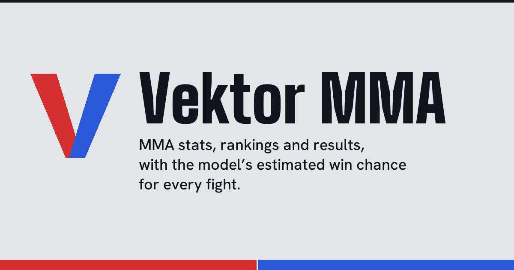

# Vektor MMA

**Who wins the next UFC fight, and why?** Vektor MMA is a free website that gives every announced UFC bout a win probability and shows the reasons behind it. There is nothing to install: everything happens on the site.

Available in [Português](https://www.vektormma.com/) · [English](https://www.vektormma.com/en) · [Français](https://www.vektormma.com/fr) · [Español](https://www.vektormma.com/es)

## Try a fight in one click

Each link opens the predictor with both fighters already in their corners.

| Dream fight | |
|---|---|
| Khabib Nurmagomedov vs. Islam Makhachev | [See the prediction →](https://www.vektormma.com/en/predictor?a=Khabib%20Nurmagomedov&b=Islam%20Makhachev) |
| Jon Jones vs. Alex Pereira | [See the prediction →](https://www.vektormma.com/en/predictor?a=Jon%20Jones&b=Alex%20Pereira) |
| Anderson Silva vs. Georges St-Pierre | [See the prediction →](https://www.vektormma.com/en/predictor?a=Anderson%20Silva&b=Georges%20St-Pierre) |
| Amanda Nunes vs. Valentina Shevchenko | [See the prediction →](https://www.vektormma.com/en/predictor?a=Amanda%20Nunes&b=Valentina%20Shevchenko) |

Want a different matchup? Pick any two fighters on the [predictor](https://www.vektormma.com/en/predictor).

## What else is on the site

| | |
|---|---|
| 🗓️ [**Events**](https://www.vektormma.com/en/events) | Upcoming cards with a pick for every bout, and past results |
| 🥊 [**Fighters**](https://www.vektormma.com/en/fighters) | Full records, fight history and stats for about 18,000 fighters |
| 🏆 [**Rankings**](https://www.vektormma.com/en/rankings) · [**Champions**](https://www.vektormma.com/en/champions) | Divisional rankings, pound-for-pound and every title reign |
| 🎮 [**Career game**](https://www.vektormma.com/en/career) | Build a fighter and take on real UFC opponents, round by round. There's a daily challenge too |
| ❌ [**Fights that never happened**](https://www.vektormma.com/en/cancelled-fights) | Khabib vs. Ferguson and other bouts that were called off: who would have won? |
| 🌍 **Ten other organizations** | [PFL](https://www.vektormma.com/en/pfl), [ONE](https://www.vektormma.com/en/one), RIZIN, KSW, OKTAGON, LFA, Cage Warriors, Jungle Fight, Invicta and Bellator |

<b>How good are the predictions?</b>

 

On 1,755 UFC fights the model never saw during training (June 2023 to October 2026):

| Way of picking the winner | Right |
|---|---|
| Flip a coin | 50% |
| Pick the fighter with more UFC wins | 48.6% |
| Pick the fighter with the better Elo rating | 55.5% |
| **Vektor MMA** | **62.7%** |

Better than guessing, far from certain: one punch can change a fight. Every live pick is saved before the event and checked after it, wrong ones included, on the [track record page](https://www.vektormma.com/en/track-record). The details are on [how the model works](https://www.vektormma.com/en/model).

<b>How is a prediction made?</b>

 

1. **Collect.** Results of thousands of past fights and each fighter's numbers: age, reach, record, striking and takedown accuracy.
2. **Learn.** A machine learning model finds how those differences relate to winning.
3. **Predict.** It compares the two fighters, once with each in the red corner, and averages the answers.
4. **Explain.** A method called SHAP shows which numbers pushed the pick to each side.

<b>How is it built?</b>

 

Data refreshed every day by GitHub Actions (Python, pandas), a scikit-learn model with SHAP, a FastAPI API on Railway and a React + TypeScript site on Vercel, with over 1,200 automated tests. The historical UFC data is also a [public dataset on Kaggle](https://www.kaggle.com/datasets/larissapavan/ufc-historical-fight-dataset-19942026), and the sources are listed on the [about page](https://www.vektormma.com/en/about).

## Author

Made by **Larissa Pavan**, software developer working with Python, AI and machine learning.

[GitHub](https://github.com/larissapavan) · [LinkedIn](https://www.linkedin.com/in/larissacpavan/) · [YouTube](https://www.youtube.com/@Vektor-MMA) · [Instagram](https://www.instagram.com/vektormma) · [TikTok](https://www.tiktok.com/@vektormma)

Vektor MMA is an independent project, not affiliated with the UFC or any other organization named here. Predictions are statistical estimates for information only, not betting advice.
