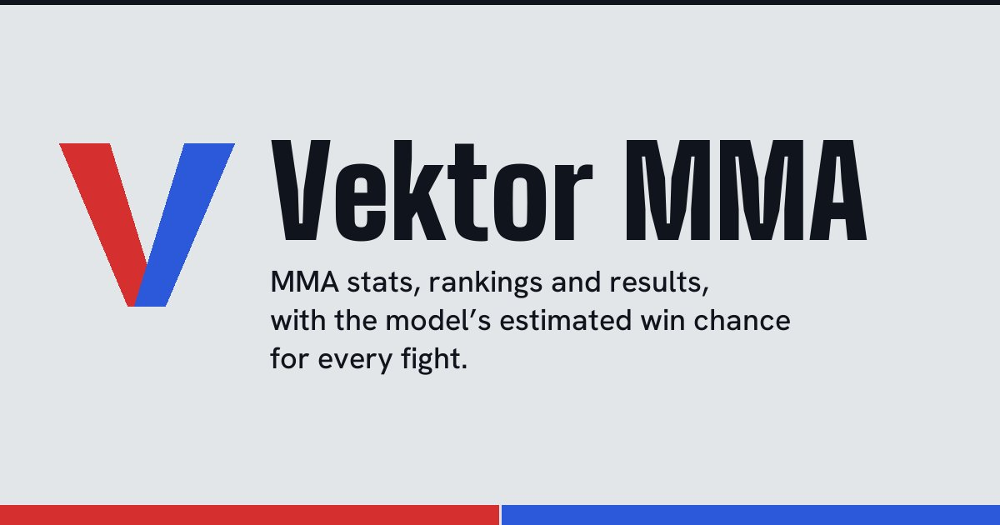

# Vektor MMA

Vektor MMA is a free website about mixed martial arts. You can look up fighters, follow events and rankings, and see the win probability my model gives for upcoming UFC fights, together with the reasons behind it.

**Live site: [www.vektormma.com](https://www.vektormma.com/)**

This is a personal project. I designed it, wrote it and keep it running on my own: the data collection, the prediction model, the API behind the site and the website itself. It is available in Portuguese, English, French and Spanish.

## What you can do on the site

There is nothing to install. Open the link and try any of these:

- **Home page.** The next UFC main event, with the model's pick and a link to the factors behind it.
- **[Fight predictor](https://www.vektormma.com/predictor).** Choose any two fighters and see the probability for each side, plus the factors that pushed it that way.
- **[Fighters](https://www.vektormma.com/fighters).** Search for an athlete and open a profile with the full career record, fight history and physical stats.
- **[Fights that never happened](https://www.vektormma.com/cancelled-fights).** UFC bouts that were booked and then called off (Khabib vs. Ferguson, McGregor vs. Chandler and others). Pick who would have won and how, then see what the model would say. Picks stay in your browser.
- **[Career game](https://www.vektormma.com/career).** Build a fighter, train, pick opponents among real UFC fighters (the model gives the chances, and a head-to-head shows where the edge is) and fight them round by round: before each round you tell the corner to attack, stick to the plan or cover up, and the right call depends on the score. Every career has three goals drawn at random (each pays ranking points) and a collection of 15 achievements to earn, some of them for playing the rounds well. Finish with a retrospect image to save or a link to share. The career and the achievements are saved in your own browser, so you can close the page and pick it up later; nothing goes to the server, and the shared link carries the card.
- **[Track record](https://www.vektormma.com/track-record).** Every prediction the model made, saved before the fight and checked after it. The wrong ones are there too.
- **[Rankings](https://www.vektormma.com/rankings), [champions](https://www.vektormma.com/champions) and [events](https://www.vektormma.com/events).** Divisional and pound-for-pound rankings, title history, upcoming cards and past results.
- **Ten other organizations.** PFL, ONE Championship, Bellator, RIZIN, KSW, LFA, Cage Warriors, OKTAGON, Jungle Fight and Invicta FC, each with its own fighters and events. ONE and PFL also have a predictor, with a note that the model learned from UFC fights.
- **[How the model works](https://www.vektormma.com/model).** The same explanation as below, with the live numbers.

## How a prediction is made

1. **Collect.** The site stores the results of thousands of past fights and the statistics of each fighter: age, height, reach, win record, how accurately they strike and take opponents down.
2. **Learn.** A program looks at those past fights and finds patterns. For example, how an age gap or a reach advantage relates to winning. This is what people mean by machine learning.
3. **Predict.** For two fighters, the program compares their numbers and returns a probability for each. It runs the comparison twice, once with each fighter listed first, and averages the two answers. Without that step the result could change depending on who is called "red corner" and who is "blue corner".
4. **Explain.** A method called SHAP breaks the answer down and shows which numbers pushed it toward one fighter or the other.

## How good is it?

Not as good as the first number I saw, and the site says so.

I measured the model on 1,755 UFC fights from June 2023 to October 2026, all later than any fight it trained on, with every fighter described as he or she stood on the morning of the fight:

| Way of picking the winner | Fights picked right |
|---|---|
| Flip a coin | 50% |
| Always pick the fighter with more UFC wins | 48.6% |
| Always pick the fighter with the better Elo rating | 55.5% |
| **Vektor MMA model** | **62.7%** |

What that means in practice:

- 62% is clearly better than guessing, and it is far from certain. MMA is hard to predict, and a single punch can change a fight. Treat the number as an informed estimate.
- The probabilities are reasonably honest in the middle of the scale and untested at the top. On the test fights, picks rated 60-65% were right 63.7% of the time and picks rated 70-80% were right 77.4%. Only 6 fights were rated 80% or more, so nothing can be said about very confident picks. The site still tells visitors to read its percentages as rough.
- This model replaced an earlier one that scored about the same (62.7% on the same fights) but was overconfident: when it was 90% sure or more it was right about 71% of the time, and its calibration error was 8.4% against 3.2% now. That earlier model's file had claimed 74.7% accuracy, from training data that is not in this repository and that I could not reproduce. A model given each fighter's career totals as of today (which include the fight itself) reaches about 73% on the same fights, which is what leaking the answer looks like. The comparison is in [`docs/model-comparison.md`](docs/model-comparison.md) and the training report in [`docs/prefight-model-report.md`](docs/prefight-model-report.md).
- The earlier model is still in the repository. Setting the environment variable `PREDICTION_MODEL=current` on the API serves it again.
- A simple logistic regression scores about the same as the gradient boosting (63.1% against 62.7% in the training report). That suggests the limit is in the information available, not in the algorithm.
- Outside the UFC it is less reliable, and I have not measured it there. The predictor also works for ONE Championship and the PFL, but those organizations' data has a record, age, height and reach and no striking or takedown numbers, so the model fills those in with averages. For fighters of those two who have no UFC profile I pull the probability halfway toward 50%, a fixed cautious factor and not a fitted one. Each of those pages says this before the first number.
- The live track record starts on 15 October 2026. It is a small sample so far, so I would not draw conclusions from it yet. The current numbers are on the [track record page](https://www.vektormma.com/track-record).

This is a learning project, not betting advice.

## What it is made of

| Part | What it does | Main tools |
|---|---|---|
| Data collection | Reads public sources, cleans and checks the data, and refreshes it every day at 07:00 UTC | Python, pandas, GitHub Actions |
| Prediction model | Estimates the winner of a fight and explains why | scikit-learn (gradient boosting, 29 inputs), SHAP |
| API | Serves the data and the predictions to the website | FastAPI, Docker, Railway |
| Website | What visitors see and click | React 19, TypeScript, Vite, Tailwind CSS, Recharts, Framer Motion, Vercel |

The data covers about 18,000 fighter profiles and more than 25,000 fights across 11 organizations.

## Engineering notes

For readers who want to see how it was built.

**Data**
- A daily GitHub Actions job pulls fresh results, rankings and photos, validates them, runs the test suite and commits the result. The API then redeploys with the new data. If one source fails, the rest of the day's data is still validated and committed, and the run is marked as failed so the problem is visible.
- Scrapers wait between requests and stay within each site's published `robots.txt` rules where one applies. When a source blocks automated access, I do not try to get around it.
- The historical UFC data is also published as a [public dataset on Kaggle](https://www.kaggle.com/datasets/larissapavan/ufc-historical-fight-dataset-19942026).

**Model**
- Most of the 29 inputs are differences between the two fighters (age, reach, win rate, striking accuracy) rather than raw values.
- Predictions are saved before each event and settled automatically afterwards. When I fixed a bug in the model, the earlier picks were kept exactly as they were shown, and the site marks them as coming from the earlier version.
- A confidence table on the site compares how sure the model said it was with how often it was right.

**Website**
- The site is a single-page React app, which search engines and link previews read poorly. A build step writes a static HTML page for every route, every active UFC fighter and every announced fight, in each of the four languages: over 3,000 addresses. Each page has its own title, description, share image, language tags and structured data.
- Every piece of text exists in all four languages. A small helper, `L(language, pt, en, fr, es)`, requires all four, so a missing translation fails the build. The texts are written the way MMA coverage is written in each language, not translated word for word.
- Accessibility: keyboard focus is visible, color contrast was measured in both the dark and light themes, and automated accessibility checks run in a real browser.
- Pages load on demand, and the API answers are cached by the browser, to keep the first visit fast.

**Quality and operation**
- More than 1,200 automated tests: Python tests for the API, the data pipeline and the model, TypeScript tests for every page, and browser tests for language switching and the HTML that search engines receive. They run on every change in GitHub Actions, together with the linter and the type checker.
- A separate job checks every 30 minutes that the site and the API are up and that the data is recent.
- The API limits how often one visitor can call it, the site sends security headers, and the API has a health check that Railway uses when it deploys, and restarts itself if it crashes.
- A cookie consent notice is set up for visitors in Europe. There is a privacy policy, and the site's own analytics do not use cookies.

## Words used above

- **API.** The part of the system that the website asks for data. It sits between the stored data and what you see on screen.
- **Machine learning.** A program that learns patterns from past examples instead of following rules written by hand.
- **Calibration.** Whether "70% sure" really means "right 70% of the time". A well calibrated model is not overconfident.
- **SHAP.** A method that shows how much each input pushed a prediction up or down.
- **Elo rating.** A scoring system, first used in chess, that goes up when you win and down when you lose, depending on how strong the opponent was.
- **Scraping.** Reading information from public web pages with a program.
- **Single-page app.** A website that loads once and then changes the screen with JavaScript, instead of loading a new page for each click.

## Data sources

Data comes from public sources: [UFCStats](http://ufcstats.com/), [UFC](https://www.ufc.com/), [ESPN MMA](https://www.espn.com/mma/), [Tapology](https://www.tapology.com/), [Sherdog](https://www.sherdog.com/), [PFL](https://pflmma.com/), [ONE Championship](https://www.onefc.com/) and [OKTAGON MMA](https://oktagonmma.com/). Coverage varies by organization. The full list, with what each source is used for, is on the site's [about page](https://www.vektormma.com/about).

## Where things are in the repository

- `frontend/` the website (React and TypeScript)
- `backend/` the API (FastAPI)
- `src/` and `models/` model training code and the trained models
- `scripts/` data collection, validation, daily update and monitoring
- `tests/` Python tests
- `docs/` model reports and the Kaggle dataset description
- `.github/workflows/` the CI, daily update and uptime jobs

## Author

**Larissa Pavan**, software developer working with Python, artificial intelligence and machine learning.

[GitHub](https://github.com/larissapavan) · [LinkedIn](https://www.linkedin.com/in/larissacpavan/) · [YouTube](https://www.youtube.com/@Vektor-MMA) · [Instagram](https://www.instagram.com/vektormma) · [TikTok](https://www.tiktok.com/@vektormma)

## Disclaimer

Vektor MMA is an independent project. It is not affiliated with, sponsored by or endorsed by the UFC, PFL, ONE Championship, Bellator MMA, RIZIN Fighting Federation, KSW, LFA, Cage Warriors, OKTAGON MMA, Jungle Fight, Invicta FC, ESPN or Sherdog. All names and trademarks belong to their owners.

Predictions are statistical estimates for information only. They do not guarantee any result.
